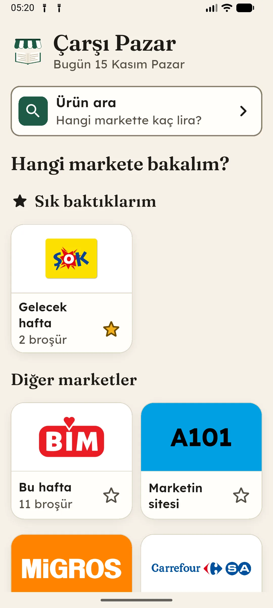
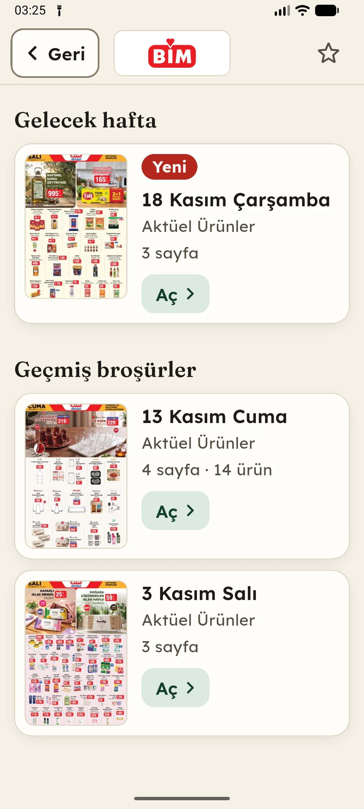
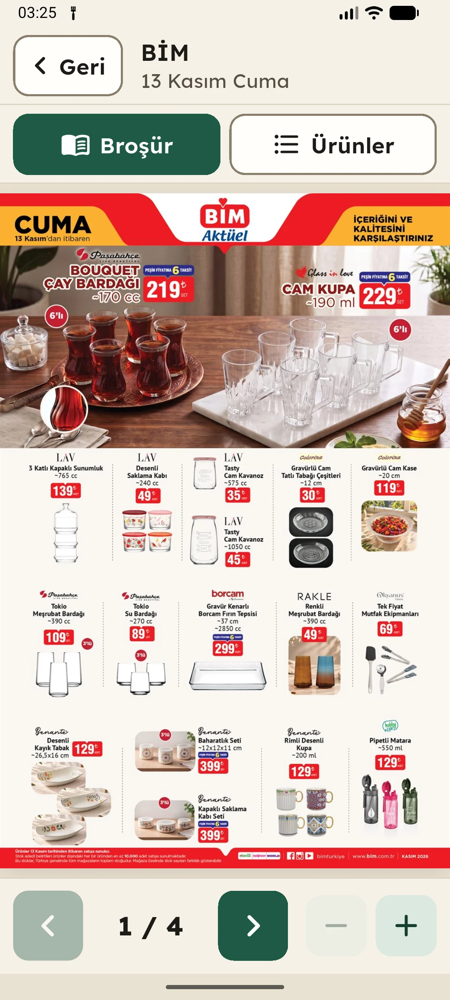
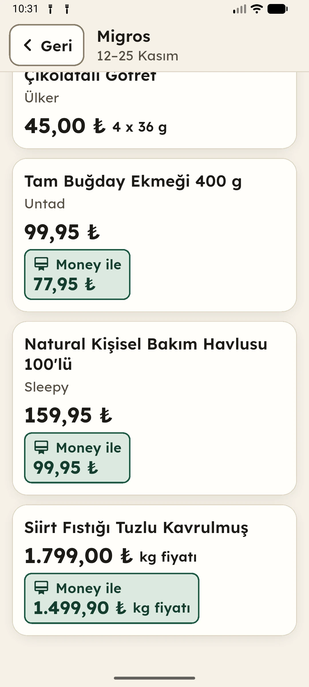
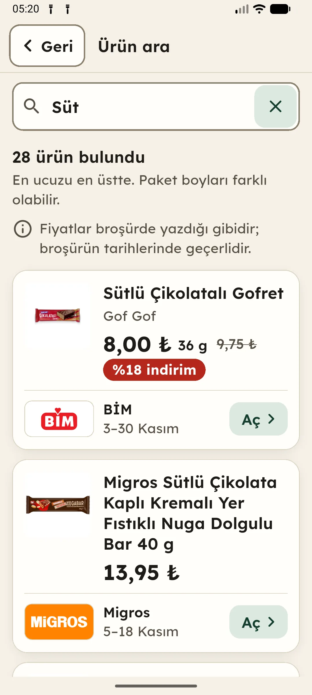
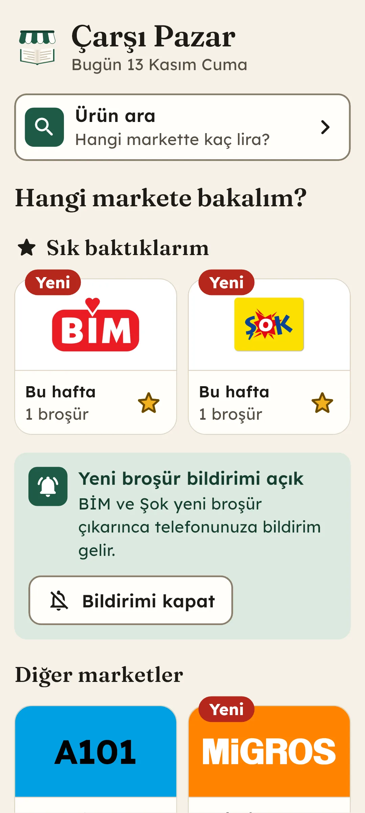
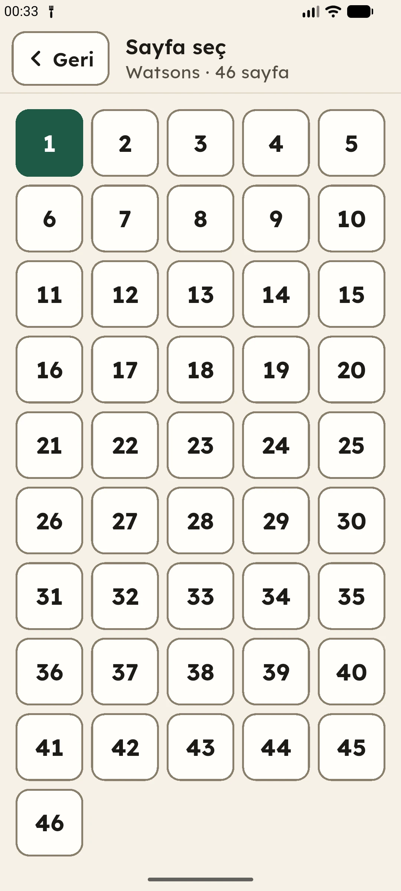
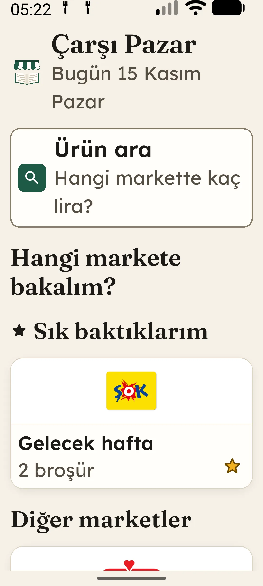
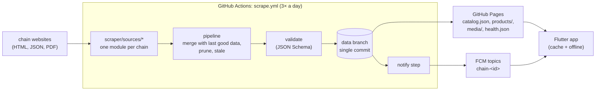

# Çarşı Pazar

> **Türkçe özet:** Çarşı Pazar, Türkiye'deki marketlerin aktüel broşürlerini tek uygulamada
> toplayan bir Android uygulamasıdır. Yaşlı kullanıcılar düşünülerek tasarlandı: büyük düğmeler,
> büyük yazı, yüksek kontrast, iki parmakla ya da + / − düğmeleriyle yakınlaştırma ve internetsiz
> okuma. Sunucusu yoktur: broşürleri günde üç kez bir GitHub Actions işi toplar, uygulama yalnızca
> yayınlanan veriyi okur. Mağazada değildir; APK dosyaları [Releases](https://github.com/adnn-mert/aktuel_brosur/releases/latest)
> sayfasındadır. Üç dosya vardır: çoğu telefon için **arm64**, eski telefonlar için **armv7**,
> bilgisayardaki emülatör için **x86_64**. Sürümler artık sabit bir anahtarla imzalanır ve birbirinin
> üzerine kurulur; v1.0.0 geçici anahtarla imzalandığı için onu kullananlar bir kez kaldırıp yeniden
> kurmalıdır.

Weekly promotional brochures ("aktüel broşür") of Turkish supermarket chains in one app, designed
for elderly users. There is no server and no budget: a scheduled GitHub Actions scraper publishes
JSON and images to GitHub Pages, and the Flutter app only reads that.

<table>
  <tr>
    <td></td>
    <td></td>
    <td></td>
    <td></td>
  </tr>
  <tr>
    <td></td>
    <td></td>
    <td></td>
    <td></td>
  </tr>
</table>

More screenshots (dark theme, large text, offline and error states) are in
[`app/design/screenshots/`](app/design/screenshots/).

## Features

- **13 chains.** Scraped: BİM, Şok, Migros, Macrocenter, Hakmar, Tarım Kredi Market, bonVeno,
  Metro, Watsons, Rossmann. Opened in an in-app web view (their sites cannot be scraped without
  bypassing protection, which this project does not do): A101, CarrefourSA, Gratis.
- **Brochures as pages:** this week, next week and the last four weeks, with a viewer built for
  people who struggle with gestures: visible + / − zoom buttons besides pinch and double tap,
  big previous / next arrows, a "3 / 8" indicator and a page picker for long catalogues.
- **Product lists with prices** where the chain publishes prices as text (BİM, Migros). A member
  price (e.g. "Money ile") is shown as a labelled second price, never instead of the shelf price.
- **Product search** across those lists ("Süt" → every matching product, whole-word matches first,
  cheapest first), jumping to the product in its brochure.
- **Favourite chains** on top of the home screen.
- **Offline reading:** brochures and product lists opened once stay readable without internet.
- **New-brochure notifications** per favourite chain (Firebase Cloud Messaging topics), offered
  once after the first favourite and switchable on the home screen.
- Light and dark theme, follows the system font size (layouts tested at 2×), screen-reader
  labels, Turkish UI from a translation file.

Design rules (touch targets ≥ 56 dp, text ≥ 18 sp, one action colour, nothing hidden behind
gestures) are written down in [`app/DESIGN.md`](app/DESIGN.md).

## Architecture



- `scraper/` (Python 3.13): `core/` holds the polite HTTP client, date parsing, PDF → WebP
  conversion, models and the pipeline; `sources/` has one file per chain; `publish.py` rewrites
  the `data` branch as a single commit (no history piles up); `notify.py` compares the new
  catalog with the previous one and sends one message per chain with new brochures.
- `schema/`: JSON Schemas for `catalog.json` and product files; nothing that fails validation is
  published.
- `app/` (Flutter, Riverpod): reads `catalog.json` from Pages, caches it and the page images.
  Chains that publish images are linked directly; only brochures that exist solely as PDF are
  converted to WebP and hosted on Pages.
- `.github/workflows/`: `scrape.yml`, `ci-scraper.yml`, `ci-app.yml`, `release.yml`.

### Robustness

- Every source runs in isolation. If one breaks, its last good data is kept and marked
  `stale`; the others are not affected. An empty result counts as an error, not as "no brochures".
- Output that does not match the schema is not published (the job fails). A source that fails
  three runs in a row gets one `source-failing` issue, which is closed automatically when it
  recovers; the job itself stays green because the other sources were published.
- Brochures more than four weeks past their end date are deleted together with their images on
  every run.
- Notifications never fail the job and stay silent on a chain's first run.

### Scraping policy

- The scraper identifies itself with an honest User-Agent that links to this repository and
  sends at most one request per second per host. A 403 or 429 is reported, not retried.
- No bot-protection bypass: no fake browser fingerprints, proxies, CAPTCHA solving or decoding
  of obfuscated content. A chain that blocks automated access is shown through its own page in
  a web view (A101, CarrefourSA, Gratis) or left out.
- Only the chains' own sites are used; no content from aggregator sites.

### Copyright

Brochure content (images, product names, prices, logos) belongs to the respective chains. This
is a portfolio project, not published on any app store, with no ads and no income. Page images
that the scraper converts from PDFs are deleted four weeks after the brochure ends. If you
represent a chain and want your content removed, please
[open an issue](https://github.com/adnn-mert/aktuel_brosur/issues); the chain will be switched
to a web view or removed.

## Running it

### Scraper

From the repository root (Python 3.13):

```bash
python -m venv .venv
source .venv/bin/activate         # Windows: .venv\Scripts\activate
pip install -e ".[dev]"
python -m pytest                  # offline: tests run against saved fixtures
python -m scraper run --only bim --dry-run   # one live source, nothing written
```

Adding a chain: see [`scraper/sources/README.md`](scraper/sources/README.md).

### App

Flutter 3.47, in `app/`:

```bash
cd app
flutter test
flutter run --dart-define=CATALOG_BASE_URL=https://adnn-mert.github.io/aktuel_brosur/
```

Without `CATALOG_BASE_URL` the app shows bundled sample data. Notifications need a Firebase
project: put its `google-services.json` into the git-ignored `secrets/` folder, then

```bash
python app/tool/firebase_defines.py          # -> secrets/firebase_defines.json
cd app
flutter run --dart-define-from-file=../secrets/firebase_defines.json --dart-define=CATALOG_BASE_URL=https://adnn-mert.github.io/aktuel_brosur/
```

No Firebase configuration is committed; without it the app simply has no notification controls.

### Release

Pushing a tag `v*` (or running `release.yml` by hand with a tag name) builds the signed APKs
(`flutter build apk --split-per-abi`) and attaches them to a GitHub Release. The workflow needs
these repository secrets (Settings > Secrets and variables > Actions):

| Secret | Content |
| --- | --- |
| `ANDROID_KEYSTORE_BASE64` | the release keystore (JKS), base64-encoded |
| `ANDROID_KEYSTORE_PASSWORD` | password of the keystore |
| `ANDROID_KEY_ALIAS` | alias of the signing key inside the keystore |
| `ANDROID_KEY_PASSWORD` | password of that key |
| `FIREBASE_GOOGLE_SERVICES_JSON` | contents of `google-services.json`; optional, without it the APKs have no notifications |

If one of the four `ANDROID_*` secrets is missing the job stops: it never publishes an APK signed
with a debug key. The keystore is decoded to a temporary file outside the repository and deleted
after the build; the job then checks every APK with `apksigner` and prints the public certificate
fingerprint so it can be compared with the previous release.

The keystore itself is never committed (`*.jks`, `*.keystore`, `key.properties` and `secrets/` are
git-ignored). Keep a backup: Android installs an update only over an app signed with the same key,
so a lost key forces every user to uninstall once. For local release builds Gradle looks for the key
in `ANDROID_KEYSTORE_*` environment variables, then `app/android/key.properties`, then
`secrets/android/keystore.properties` (see [`app/README.md`](app/README.md)).

## Download

Android APKs: [latest release](https://github.com/adnn-mert/aktuel_brosur/releases/latest). Each
release has three files, named `carsi-pazar-<tag>-<abi>.apk`:

| File | For |
| --- | --- |
| `...-arm64.apk` | most phones (recommended) |
| `...-armv7.apk` | older 32-bit phones; try it if arm64 does not install |
| `...-x86_64.apk` | emulators on a PC |

Allow installing from unknown sources when the phone asks. Releases are signed with a permanent
project key (not a store key), so a newer version installs over the previous one and keeps the
favourites. **v1.0.0 was signed with a temporary debug key:** anyone who installed it has to
uninstall it once (favourites are reset) before installing a later version.

## How it was built

The project was planned and reviewed by a Claude orchestrator session; the code was written by
Claude subagents with the `worker` (scraper, data layer, workflows, tests) and `designer` (UI and
UX) roles defined in [`.claude/agents/`](.claude/agents/). The orchestrator wrote the tasks,
read the diffs, re-ran the tests and checked the app on an emulator before committing.

## Status and limitations

- Android only. The code is written to be iOS-compatible, but iOS has never been built or tested
  (no Mac).
- Pinch zoom is verified only in widget tests and on the emulator, not yet by hand on a real
  device.
- Prices are shown exactly as the chain prints them; nothing is compared or corrected.
- Image-only brochures (most chains) are not searchable yet; reading prices from images (OCR) is
  a later phase.
- Chains in a web view depend on their own websites.

## License

The code is released under the [MIT License](LICENSE). Brochure content (images, texts and
prices) belongs to the respective chains and is not covered by this license.
